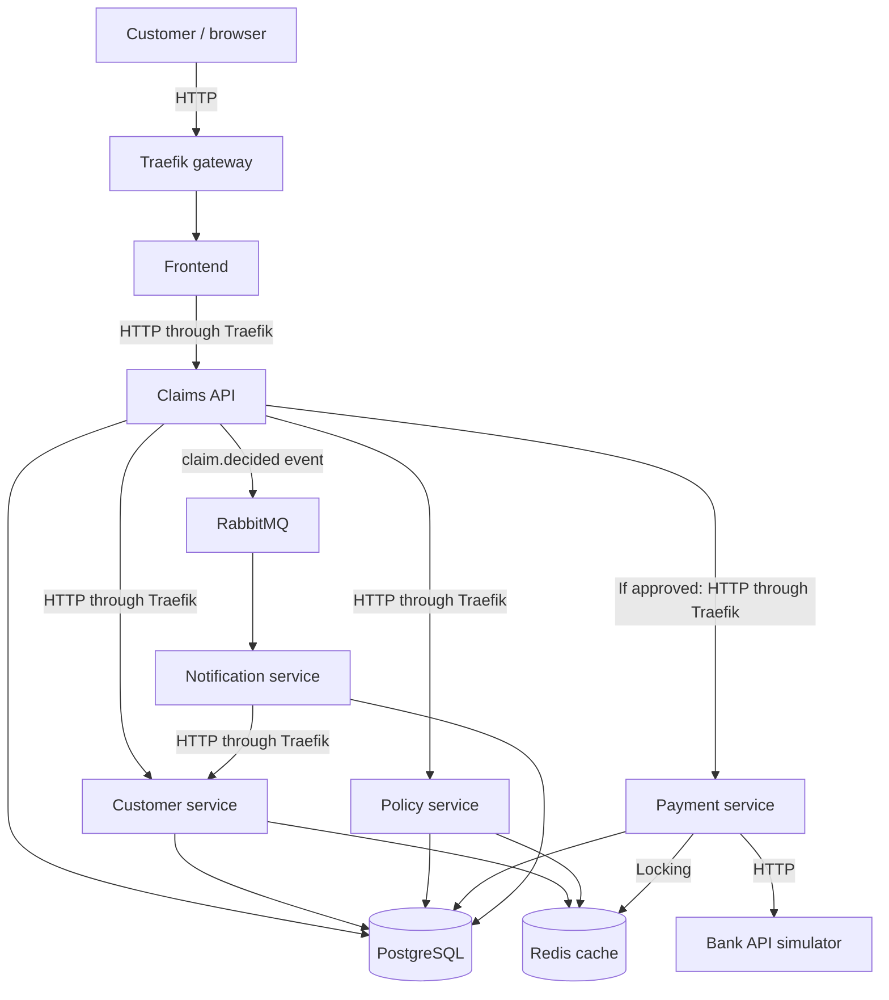
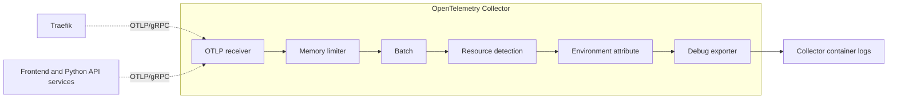

# Claims application architecture

See the [observability overview](./observability-overview.md) for a
beginner-friendly explanation. These diagrams describe the configured
architecture; actual trace coverage must be verified at runtime.

## Application architecture

Solid arrows are HTTP calls, messages, or data access. Calls labelled
**through Traefik** use its internal entry point; the bank call is direct.

## Telemetry flow

The dotted arrows represent configured OTLP destinations, not a guarantee that
every operation produces a span. The collector currently has a trace pipeline
only.

The application services and collector share `claims-net`. The collector also
listens for OTLP/HTTP internally, but the application configuration uses
OTLP/gRPC on port `4317`.
